# Tuần 9 - Kết quả thực hành

## Lab 1: API Versioning

### Test v1 và Sunset header

Gọi `GET /api/v1/users/1`: trả HTTP 200, thông tin user có `full_name` và header `Sunset`.

<!-- Thêm ảnh test v1 tại đây -->

### Test v2

Gọi `GET /api/v2/users/1`: trả HTTP 200, thông tin user có `first_name` và `last_name`.

<!-- Thêm ảnh test v2 tại đây -->

### Test user không tồn tại

Gọi `GET /api/v1/users/999`: trả HTTP 404.

<!-- Thêm ảnh test 404 tại đây -->

### Test tạo user

Gọi `POST /api/v2/users` với `first_name`, `last_name`, `email`: trả HTTP 201 và user vừa tạo. Có thể gọi GET theo ID mới ở cả v1 và v2.

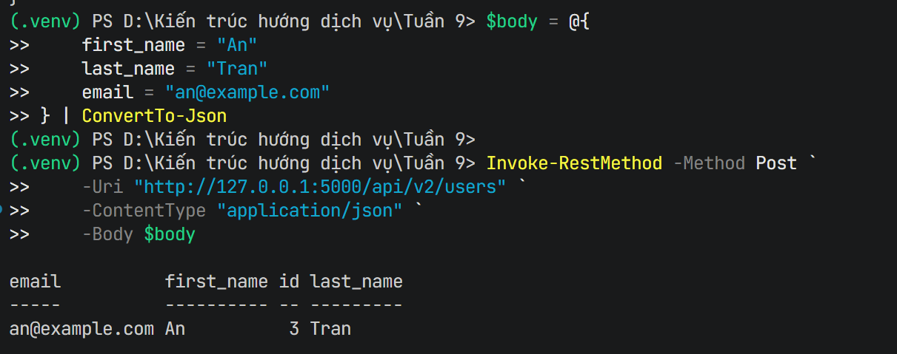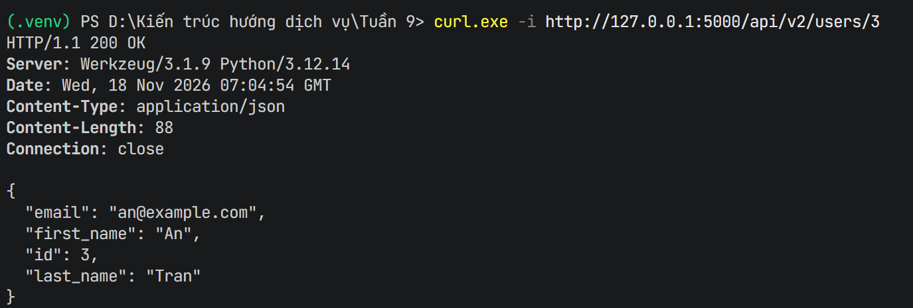

<!-- Thêm ảnh test POST và GET user mới tại đây -->

### Test dữ liệu không hợp lệ

Gọi `POST /api/v2/users` với dữ liệu thiếu hoặc rỗng: trả HTTP 400.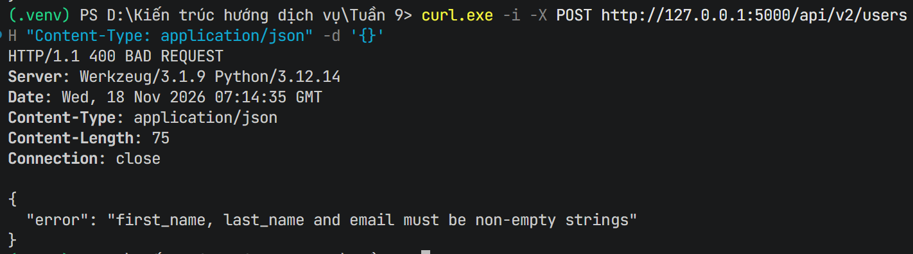

<!-- Thêm ảnh test dữ liệu không hợp lệ tại đây -->

## Lab 2: Header Versioning

- Không gửi header: `GET /users/1` trả v2 và `X-API-Version-Served: 2`.
- 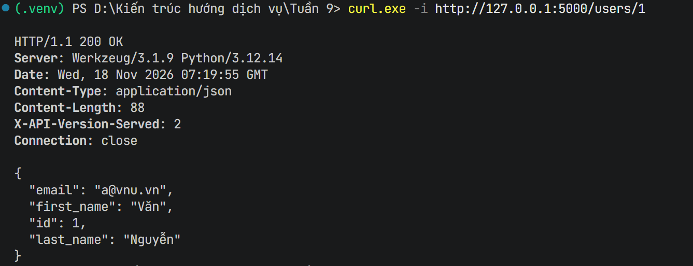
- Gửi `X-API-Version: 1`: trả `full_name` và header xác nhận phiên bản 1.
- 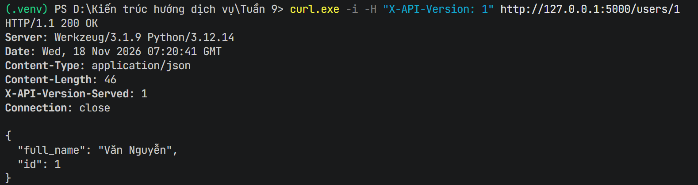
- Gửi `X-API-Version: 2024-06-20`: trả dữ liệu theo phiên bản ngày.
- 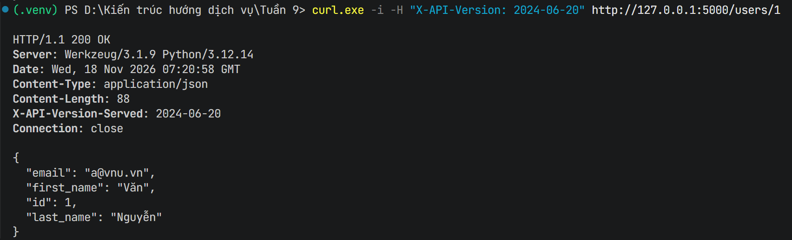
- Gửi `X-API-Version: 99`: trả HTTP 400.
- Gọi user không tồn tại: trả HTTP 404.

<!-- Thêm ảnh kiểm thử Lab 2 tại đây -->

## Lab 3: Sunset Middleware

- Gọi `GET /api/v1/users/1` trước mốc sunset (31/12/2026 lúc 23:59:59 UTC) trả HTTP 200, có `full_name` và các header `Sunset`, `Deprecation` và `Link`.

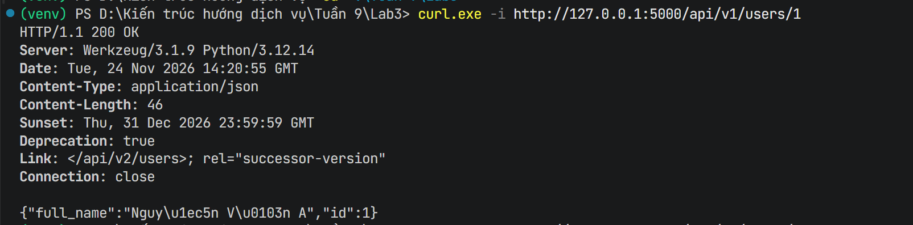

- Gọi từ mốc sunset trở đi trả HTTP 410 với `error` là `gone` và `use_instead` là `/api/v2/users`.

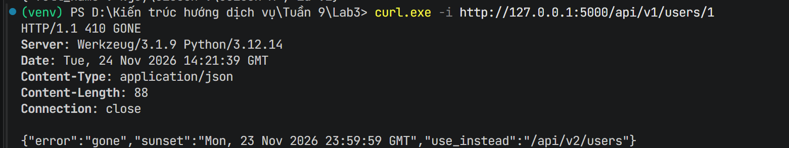

- Mỗi lần gọi v1 ghi log `deprecated_call` kèm đường dẫn và địa chỉ IP.

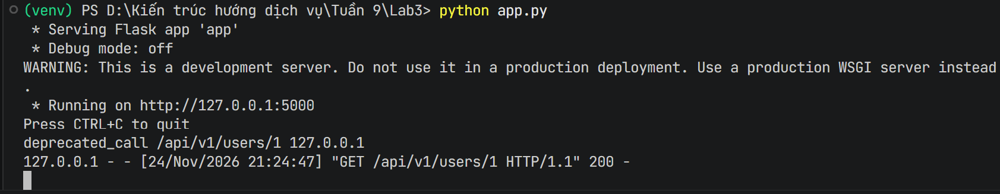

<!-- Thêm ảnh kiểm thử Lab 3 tại đây -->

## Lab 4: Blue-Green Routing

- Gọi `POST /orders` với `X-Cohort: beta` hoặc `internal` trả HTTP 201 và `X-Order-Handler: v2`.
  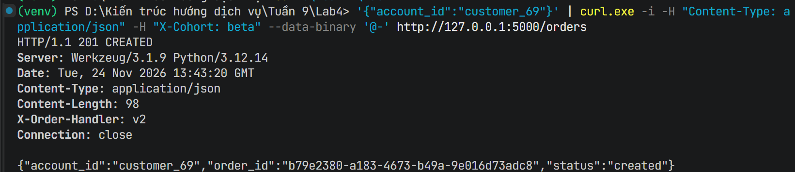
- Tài khoản `acct_42` hoặc `acct_99` trong allow-list cũng được chuyển sang v2.
  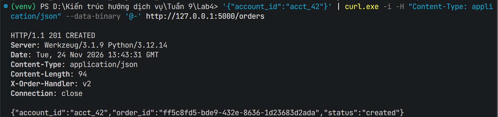
- Ở mức rollout 5%, `customer_195` thuộc bucket 4 nên trả HTTP 201 (v2). `customer_69` thuộc bucket 5 nên trả HTTP 200 (v1).
- 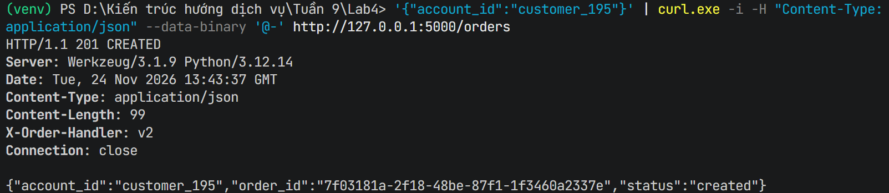
- Khi đặt `V2_PERCENT=100`, gọi lại với `customer_69` trả HTTP 201 và `X-Order-Handler: v2`.
- 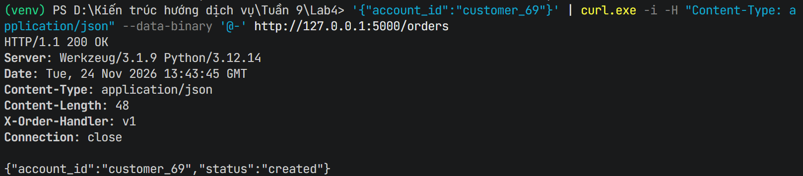

<!-- Thêm ảnh kiểm thử Lab 4 tại đây -->
