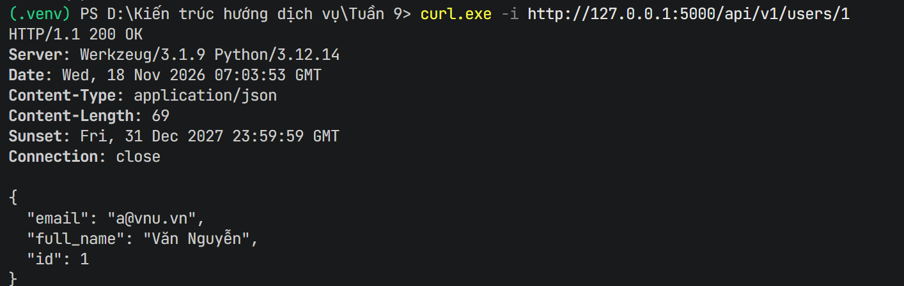
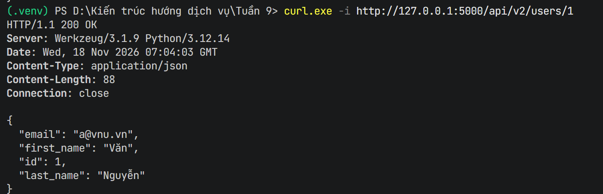
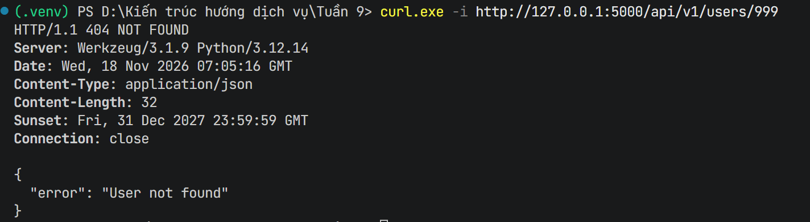

# Tuần 9 - Kết quả thực hành

## Lab 1: API Versioning

### Test v1 và Sunset header

Gọi `GET /api/v1/users/1`: trả HTTP 200, thông tin user có `full_name` và header `Sunset`.

<!-- Thêm ảnh test v1 tại đây -->

### Test v2

Gọi `GET /api/v2/users/1`: trả HTTP 200, thông tin user có `first_name` và `last_name`.

<!-- Thêm ảnh test v2 tại đây -->

### Test user không tồn tại

Gọi `GET /api/v1/users/999`: trả HTTP 404.

<!-- Thêm ảnh test 404 tại đây -->

### Test tạo user

Gọi `POST /api/v2/users` với `first_name`, `last_name`, `email`: trả HTTP 201 và user vừa tạo. Có thể gọi GET theo ID mới ở cả v1 và v2.

<!-- Thêm ảnh test POST và GET user mới tại đây -->

### Test dữ liệu không hợp lệ

Gọi `POST /api/v2/users` với dữ liệu thiếu hoặc rỗng: trả HTTP 400.

<!-- Thêm ảnh test dữ liệu không hợp lệ tại đây -->
